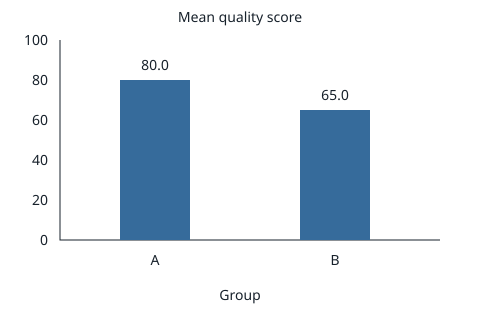

# Synthetic quality study

This miniature manuscript uses fictional data for verification testing.

## Table 1

Mean quality score, on a 0–100 scale, by group.

| Group | Mean |
|---|---:|
| A | 80.0 |
| B | 65.0 |

## Figure 1

Bars show group means on the same 0–100 quality scale as Table 1.
